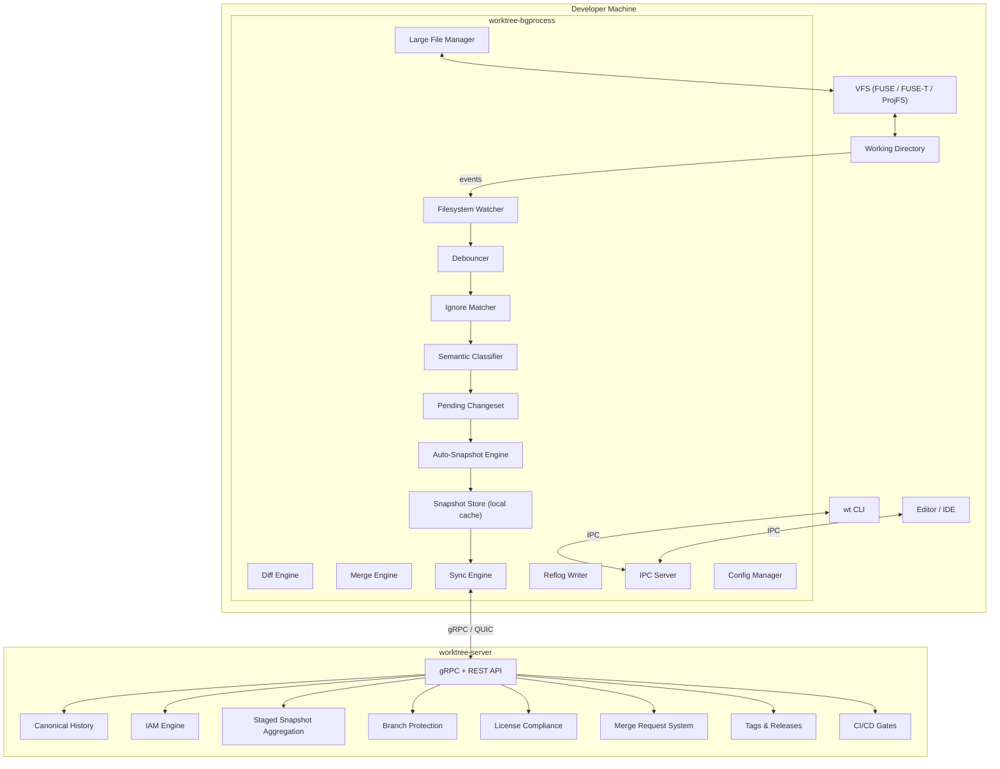

## The split that defined everything

Most version control systems pick a lane. Git is a local tool that optionally talks to remotes. Perforce is a hosted platform that requires a server. Each model has strengths, and each has a cost you pay forever.

Git's model gives you speed and offline capability, but collaboration is an afterthought — push when you are ready, hope nobody else touched the same files. Perforce's model gives you centralized authority, but developers are tethered to the server. Lose the connection, lose the ability to work.

W0rktree refused to pick. We wanted a local process that is fast, works offline, and owns the developer's working directory. We also wanted a server that is authoritative, enforces policies, and provides real-time collaboration. Not one or the other. Both. Running simultaneously, with a strict contract between them.

That contract is the architectural spine of the entire system: **the background process never enforces access control, and the server never watches files.** No overlap. No duplication. Each runtime does what it is best at, and nothing else.

## The background process — worktree-bgprocess

The background process (also called `worktree-worker` in the codebase) is a persistent local daemon that runs on the developer's machine. It is the only process that touches the working directory. Everything the developer experiences — file watching, auto-snapshots, branch switching, merge conflict resolution, large file access — flows through this single process.

Under the hood, it is a set of async subsystems running as tasks in a single Tokio runtime. No thread pools, no separate processes, no IPC between internal components. One runtime, many cooperating tasks.

### Subsystems

Here is every subsystem in the bgprocess, in the order they appear in the data pipeline:

**Filesystem Watcher.** Uses the `notify` crate with OS-native backends — inotify on Linux, FSEvents on macOS, ReadDirectoryChangesW on Windows. Raw filesystem events (create, modify, delete, rename) stream into the watcher as fast as the OS delivers them.

**Debouncer.** Collapses rapid-fire events into stable change sets. A 200ms sliding window absorbs the burst of events that a single save produces (temp file write, rename, metadata update). The debouncer emits one event per logical change, not one per syscall.

**Ignore Matcher.** Filters events against compiled ignore patterns from `.wt-tree/ignore` files. Pattern compilation happens once at startup and again on hot-reload. This is intentionally placed before the semantic classifier — there is no reason to classify a file we are going to ignore.

**Semantic Classifier.** Categorizes each change by what it means, not just what file was touched. Categories include code change, config change, dependency change (lockfiles, manifests), documentation change, and asset change. The classifier drives snapshot metadata and powers the server's change aggregation.

**Pending Changeset.** An in-memory accumulator that collects classified changes until the auto-snapshot engine decides to act. It tracks file paths, change types, byte deltas, and timestamps. The changeset is the unit of evaluation for all snapshot triggers.

**Auto-Snapshot Engine.** Evaluates the pending changeset against configurable triggers and decides when to create a snapshot. Four triggers:

- Inactivity timeout — no new changes for N seconds (default: 30s)
- Max changed files — changeset exceeds N files (default: 50)
- Max changed bytes — changeset exceeds N bytes (default: 10MB)
- Branch switch — always snapshot before switching

When any trigger fires, the engine drains the pending changeset, computes a tree hash, and creates a new snapshot in the local DAG.

**Snapshot Store.** A content-addressable DAG of snapshots stored locally. Each snapshot is identified by its BLAKE3 hash. The store handles deduplication, delta compression between adjacent snapshots, and garbage collection of orphaned objects. Local storage is a cache, not canonical — the server is the source of truth.

**Diff Engine.** Computes diffs between any two snapshots, any snapshot and the working directory, or any two branches. Supports rename detection with configurable similarity thresholds. The output format is structured (not text patches), which allows the merge engine and UI layer to operate on semantic changes.

**Merge Engine.** Handles three-way merges using the nearest common ancestor in the snapshot DAG. Non-conflicting changes merge automatically. Conflicts produce structured conflict markers that the CLI and editor integrations understand. There is one merge algorithm, not four.

**Sync Engine.** Manages bidirectional communication with the remote server over gRPC/QUIC. Pushes staged snapshots, pulls remote changes, negotiates delta transfers. Operates on its own async loop with configurable intervals. When the server is unreachable, the sync engine queues operations and retries with exponential backoff.

**Large File Manager.** Splits files exceeding a configurable threshold using FastCDC (content-defined chunking). Serves large file content through platform-native virtual filesystems — FUSE on Linux, FUSE-T on macOS, ProjFS on Windows. Applications see regular files. The chunking and lazy loading are invisible to editors and build tools.

**Reflog Writer.** Maintains a local append-only log of every operation — snapshot creation, branch switch, merge, sync event, config change. The reflog is the recovery mechanism. If anything goes wrong, the reflog tells you exactly what happened and in what order.

**IPC Server.** Listens for commands from the CLI and editor integrations. Unix domain sockets on Linux and macOS, named pipes on Windows. Every `wt` command communicates with the bgprocess through this channel. The protocol is length-prefixed JSON messages over the socket.

**Config Manager.** Reads and hot-reloads configuration from the hierarchy: system defaults, user global, root `.wt/config.toml`, tree `.wt-tree/config.toml`, environment variables. Watches config files and propagates changes to all subsystems without requiring a restart.

### Data flow

Every file change flows through the same pipeline:


The pipeline is unidirectional. The watcher never blocks on the snapshot engine. The snapshot engine never blocks on the sync engine. Each stage processes at its own pace, with bounded channels between them. Backpressure is handled by dropping redundant filesystem events, never by dropping snapshots.

A concrete example: you save a file in your editor. The OS delivers a burst of events (create temp, write temp, rename temp to target, update metadata). The debouncer collapses these into a single "modified" event for the target file. The ignore matcher checks whether the file matches any ignore pattern. The semantic classifier tags it as a code change. The pending changeset absorbs it. Thirty seconds later, with no further changes, the inactivity trigger fires. The auto-snapshot engine creates a snapshot. The sync engine picks it up and pushes it to the server as a staged snapshot.

Total developer effort: zero. You saved a file. W0rktree handled the rest.

## The remote server — worktree-server

The server is the canonical source of truth. It stores authoritative history, enforces every policy, and provides the collaboration layer that makes W0rktree more than a local tool.

### Responsibilities

**Canonical history storage.** The server maintains the authoritative snapshot DAG for every tree in every worktree. Local storage on developer machines is a cache. If a developer's machine is destroyed, the server has everything. If there is a disagreement between local and remote history, the server wins.

**Multi-tenant management.** Every actor in W0rktree is a tenant — a user or organization with verified identity. The server manages tenant registration, authentication, organization membership, team hierarchies, and cross-tenant relationships. Tenant isolation is enforced at the storage layer, not just the API layer.

**IAM enforcement.** The server evaluates every operation against the full access control policy. This includes tenant-level permissions, team-level roles, tree-level access rules, path-level restrictions, and ABAC conditions. The evaluation is atomic — all applicable rules are evaluated together, and the most restrictive result applies.

```toml
# Example: tree-level access policy
# .wt-tree/access/teams.toml

[team.backend]
role = "developer"
paths = ["src/api/", "src/services/"]

[team.frontend]
role = "developer"
paths = ["src/ui/", "src/components/"]

[team.devops]
role = "maintainer"
```

**Cross-tenant access enforcement.** When tenant A grants tenant B access to a tree, the server enforces the grant's scope (read, write, admin), expiration, and path restrictions. Cross-tenant access never inherits — each grant is explicit.

**Staged snapshot aggregation and visibility.** The server collects staged snapshots from all connected bgprocess instances and presents a real-time view of active work across the team. When two developers have staged changes to overlapping files, the server generates advisory warnings. This is the collaboration feature that replaces "hey, are you working on that file too?" in Slack.

**Branch protection enforcement.** The server enforces branch protection rules: required reviewers, required CI checks, no direct pushes, no deletion. These rules exist only on the server and cannot be bypassed by the bgprocess.

**License compliance enforcement.** Every sync, export, fork, and copy operation is checked against the license policy. Files with SPDX license tags are tracked, and the server ensures that grant levels (read-only, modify, redistribute) are respected. Proprietary paths are excluded from public archives automatically.

**Merge request system.** The server hosts merge requests (W0rktree's equivalent of pull requests). Reviews, approvals, CI status, and merge execution all happen server-side. The bgprocess pushes snapshots; the server decides whether they can merge.

**Tag and release management.** Tags are server-side objects that point to specific snapshots. Releases aggregate tags with metadata, changelogs, and artifacts. Tags are immutable once created — consistent with the append-only history model.

**CI/CD gate integration.** The server exposes webhook and API endpoints for CI/CD systems. Branch protection rules can require passing CI checks before a merge is allowed. The server tracks check status and blocks merges until all required gates pass.

**API surface.** The server exposes a gRPC API for the bgprocess sync protocol and a REST API for the admin panel, CLI (when operating without a local bgprocess), and third-party integrations. Both APIs enforce the same IAM policy.

## The separation of concerns

The contract between the two runtimes is not a guideline. It is an architectural invariant enforced by the codebase.

### The bgprocess NEVER:

- **Enforces access control.** It reads access policies for display purposes (showing the developer what permissions they have), but it never blocks an operation based on those policies. All enforcement happens server-side. If the bgprocess is compromised or modified, it cannot grant itself extra permissions.
- **Stores canonical history.** Local snapshot storage is a cache. It is populated by sync and pruned by garbage collection. If the local store diverges from the server, the server's state is authoritative.
- **Creates server-side data.** The bgprocess pushes snapshots to the server for staging, but the server decides whether to accept them, where to store them, and how to index them. The bgprocess cannot write directly to server storage.

### The server NEVER:

- **Watches files.** The server has no knowledge of individual developers' working directories. It does not know which files are open, which editor is running, or what the filesystem looks like. All file-level awareness lives in the bgprocess.
- **Touches the working directory.** The server cannot read, write, or modify files on the developer's machine. All working directory operations — checkout, restore, clean — are bgprocess operations triggered by the developer.
- **Creates auto-snapshots.** Snapshots are created locally by the bgprocess. The server receives them via sync. The server can create snapshots from merge operations, but it never creates them from filesystem observation.

This separation has a practical consequence: you can work entirely offline. The bgprocess continues watching files, creating snapshots, switching branches, and merging — everything except sync. When connectivity returns, the sync engine catches up. The server does not need to be involved in any local operation.

## Platform-specific implementations

W0rktree runs on Linux, macOS, and Windows. The bgprocess adapts to each platform's native facilities.

### Local storage paths

```
Windows:  %APPDATA%\W0rkTree\
Linux:    ~/.local/share/w0rktree/
macOS:    ~/Library/Application Support/W0rkTree/
```

The storage directory contains the snapshot store, reflog, config cache, PID files, and IPC socket paths. It is never inside the working directory — unlike `.git/`, which lives in the repository root. This means you can have multiple worktrees on the same machine without storage directories polluting your project tree.

### Service manager integration

The bgprocess integrates with each platform's native service manager for automatic startup and lifecycle management:

```toml
# Linux: systemd unit (installed by `wt worker install`)
# ~/.config/systemd/user/worktree-worker.service
[Unit]
Description=W0rktree Background Worker
After=network.target

[Service]
Type=simple
ExecStart=/usr/local/bin/worktree-worker
Restart=on-failure
RestartSec=5

[Install]
WantedBy=default.target
```

```toml
# macOS: launchd plist (installed by `wt worker install`)
# ~/Library/LaunchAgents/com.w0rktree.worker.plist
# Runs on login, restarts on failure, logs to local storage
```

On Windows, the bgprocess registers as a Windows Service via `wt worker install`. It runs under the user's account, starts automatically at login, and integrates with the Windows Event Log for diagnostics.

### Virtual filesystem backends

Large file access uses platform-native VFS:

| Platform | VFS Backend | Notes |
|----------|-------------|-------|
| Linux    | FUSE        | Requires `libfuse3`. Mount point at `<worktree>/.wt-vfs/` |
| macOS    | FUSE-T      | Userspace FUSE without kernel extension. No SIP issues |
| Windows  | ProjFS      | Windows Projected File System. Integrated with Explorer |

The VFS layer is optional. If a developer prefers to download all files eagerly, they can disable lazy loading in config. But for repositories with large assets — game art, ML models, video — the VFS means cloning does not require downloading every file upfront.

### IPC mechanism

| Platform       | Transport          | Path                                             |
|----------------|--------------------|--------------------------------------------------|
| Linux / macOS  | Unix domain socket | `$XDG_RUNTIME_DIR/w0rktree/worker.sock`          |
| Windows        | Named pipe         | `\\.\pipe\w0rktree-worker`                       |

The CLI (`wt`) connects to the IPC socket on every invocation. If the bgprocess is not running, the CLI starts it automatically. If the socket is stale (process crashed but PID file remains), the CLI detects the stale PID, cleans up, and restarts.

## Lifecycle

### Startup

When the bgprocess starts — whether via service manager, CLI, or manual invocation — it follows a deterministic sequence:

1. Read configuration from the full hierarchy (system, user, worktree root, tree-level, environment)
2. Compile ignore patterns from all `.wt-tree/ignore` files
3. Initialize the local snapshot store, verify integrity
4. Start the filesystem watcher on all registered tree roots
5. Start the IPC server (bind socket / create named pipe)
6. Authenticate with the remote server (token refresh if expired)
7. Start the sync loop (push staged snapshots, pull remote changes)
8. Write PID file
9. Emit startup event to reflog

```
$ wt worker status
Worker Status
  PID:           48291
  Uptime:        3h 42m
  State:         running
  Trees watched: 4
  Pending sync:  2 snapshots
  Last sync:     12s ago
  Memory:        47 MB
  IPC:           /run/user/1000/w0rktree/worker.sock

Watcher
  Backend:       inotify
  Directories:   312
  Ignore rules:  89 patterns (3 files)

Sync
  Server:        https://w0rktree.example.com
  Protocol:      gRPC/QUIC
  Connection:    established
  Latency:       23ms

Storage
  Local path:    /home/sean/.local/share/w0rktree/
  Snapshots:     1,847
  Objects:       24,319
  Disk usage:    892 MB
  Last GC:       1h 12m ago
```

### Runtime loops

Once started, the bgprocess runs several concurrent async loops:

**Watcher loop.** Continuously receives filesystem events, runs them through the debounce/ignore/classify pipeline, and feeds the pending changeset. This loop never sleeps — it blocks on the OS event stream.

**Snapshot evaluation loop.** Checks the pending changeset against auto-snapshot triggers on a configurable interval (default: 1s). When a trigger fires, it creates a snapshot and resets the changeset.

**Sync loop.** Pushes staged snapshots to the server and pulls remote changes. Default interval is 5s when changes are pending, 30s when idle. The interval adapts — if the server is slow or unreachable, backoff kicks in.

**IPC listener loop.** Accepts connections from the CLI and editor integrations. Each connection spawns a handler task. Commands are processed concurrently, with a mutex on operations that modify branch state.

**Config watcher loop.** Watches `.wt/config.toml` and `.wt-tree/config.toml` files for changes. On modification, re-reads the config, recompiles ignore patterns, and propagates new settings to all subsystems. No restart required.

**Health check loop.** Periodically verifies that the filesystem watcher is alive, the IPC socket is accepting connections, and the sync engine is responsive. If a subsystem is unresponsive, it is restarted. If the restart fails, the bgprocess logs the failure and continues with degraded functionality.

**Maintenance loop.** Runs garbage collection on the local snapshot store, prunes old reflog entries beyond the retention window, and compacts pack files. Runs every 30 minutes by default.

### Shutdown

Graceful shutdown follows a reverse sequence:

1. Stop accepting new IPC connections, drain in-flight requests
2. Stop the filesystem watcher
3. Create a final snapshot of any pending changes
4. Complete any in-progress sync operations (with a timeout)
5. Flush the reflog to disk
6. Remove PID file
7. Close IPC socket / named pipe
8. Exit

The shutdown sequence has a configurable timeout (default: 10s). If any step exceeds the timeout, it is skipped and the process exits. The next startup will detect the unclean shutdown and run recovery.

### Crash recovery

When the bgprocess starts and detects a stale PID file (previous instance did not shut down cleanly), it enters recovery mode:

1. **Stale PID detection.** Check if the PID in the file is still running. If not, the previous instance crashed.
2. **Working directory scan.** Walk the watched directories and compare current state against the last known snapshot. Identify any changes that happened while the bgprocess was down.
3. **Journal replay.** If the snapshot store has an incomplete write (journal entry without a corresponding committed object), replay or discard it.
4. **Reflog reconciliation.** Verify that the reflog is consistent with the snapshot store. Append a recovery entry noting the unclean shutdown and any changes detected.
5. **Resume normal operation.** Start all subsystems and enter the standard runtime loops.

```
$ wt worker status
Worker Status
  PID:           51003
  Uptime:        4s
  State:         recovering
  Recovery:      scanning working directory (312/312 dirs)
  Last clean:    2h 17m ago

Recovery Log
  Stale PID:     48291 (not running)
  Untracked:     3 files modified since last snapshot
  Journal:       1 incomplete write discarded
  Action:        creating recovery snapshot
```

Recovery is automatic and transparent. The developer does not need to run any commands. If they open a terminal and run `wt status` while recovery is in progress, they see the recovery state. Once complete, everything works as if the crash never happened.

## Architecture overview



## Why this matters

Early prototypes did not have this clean separation. The bgprocess validated access rules locally. When a developer tried to push to a protected branch, the bgprocess checked the policy and blocked the operation before it ever reached the server.

It worked. It was fast. And it was wrong.

The problem surfaced when we started testing with multiple developers. An admin changes a branch protection rule on the server. Developer A syncs and gets the new rule. Developer B is on an airplane. Developer B's bgprocess has the old rule cached. Developer B pushes to the protected branch. The local check passes because the cached policy is stale. The server accepts the push because... wait, why would it? It should enforce the rule too.

So now we had enforcement in two places. The bgprocess enforced with potentially stale data. The server enforced with authoritative data. The bgprocess enforcement was redundant at best and wrong at worst. When they disagreed, which one was right?

The answer was obvious: the server is always right. So we ripped out every access check from the bgprocess. The bgprocess reads policies for display — showing the developer what permissions they have, rendering path restrictions in `wt status`. But it never blocks an operation based on local policy evaluation. Every enforcement decision is made by the server, with the current authoritative policy, at the time of the operation.

This had three consequences:

**Simplicity.** The bgprocess is simpler. It does not need a policy evaluation engine, a rule cache, a cache invalidation strategy, or conflict resolution between local and remote policy states. It watches files and creates snapshots. That is hard enough.

**Security.** The server is the single enforcement point. A compromised bgprocess cannot grant itself extra permissions by modifying the local policy cache. The server evaluates the policy fresh on every request.

**Consistency.** Policy changes take effect immediately for all operations that hit the server. There is no propagation delay, no cache TTL, no "eventually consistent" window where different clients enforce different rules.

The two-runtime architecture is not just a deployment convenience. It is a security boundary. The bgprocess is an untrusted client that happens to run on the developer's machine. The server is the authority. Every design decision flows from that asymmetry.

## Configuration reference

The bgprocess behavior is fully configurable at every level of the config hierarchy:

```toml
# .wt/config.toml — worktree-level configuration

[worker]
log_level = "info"                # trace, debug, info, warn, error

[worker.watcher]
debounce_ms = 200                 # event collapse window
poll_fallback = false             # use polling if native watcher fails

[worker.snapshot]
inactivity_timeout_s = 30         # auto-snapshot after N seconds of inactivity
max_changed_files = 50            # auto-snapshot when changeset exceeds N files
max_changed_bytes = 10485760      # auto-snapshot when changeset exceeds N bytes (10MB)
on_branch_switch = true           # always snapshot before switching branches

[worker.sync]
interval_active_s = 5             # sync interval when changes are pending
interval_idle_s = 30              # sync interval when idle
retry_backoff_base_s = 2          # exponential backoff base for retries
retry_backoff_max_s = 300         # max backoff (5 minutes)

[worker.storage]
gc_interval_m = 30                # garbage collection interval
gc_grace_period_h = 24            # grace period before deleting unreferenced objects
pack_threshold = 1000             # pack loose objects after N accumulate

[worker.large_files]
threshold_bytes = 10485760        # files above 10MB use chunked storage
chunk_target_bytes = 1048576      # target chunk size (1MB)
vfs_enabled = true                # serve large files via VFS
vfs_cache_mb = 512                # VFS read cache size

[worker.ipc]
max_connections = 32              # concurrent IPC connections
request_timeout_s = 30            # per-request timeout

[worker.health]
check_interval_s = 60             # health check interval
restart_on_failure = true         # restart unresponsive subsystems
```

Every value has a sensible default. Most developers never touch this file. But when you are managing a monorepo with thousands of files and need to tune the debounce window or snapshot thresholds, the knobs are there.

## The bottom line

W0rktree's two-runtime architecture is the foundation that every other feature builds on. Staged snapshot visibility works because the bgprocess creates snapshots locally and the server aggregates them. Declarative access control works because the server is the single enforcement point. Offline capability works because the bgprocess handles everything local without calling the server.

Neither runtime is optional. Neither duplicates the other. The bgprocess is fast, local, and untrusted. The server is authoritative, shared, and the final word on policy. That asymmetry is not a limitation — it is the design.
